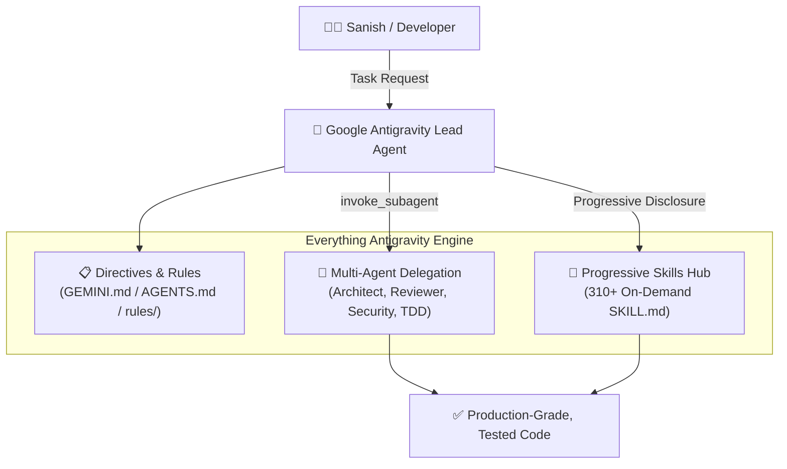

# Everything Antigravity 🚀

[](https://opensource.org/licenses/MIT)
[](https://github.com/gyawalisanish0/Everything_Antigravity)
[](./skills)
[](./agents)
[](./scripts)

> **The ultimate performance optimization toolkit, autonomous agent personas, engineering rules, and 300+ modular skills for Google Antigravity.**  
> *Authored and maintained by **[Sanish Gyawali](https://github.com/gyawalisanish0)***

---

## 🌟 What is Everything Antigravity?

Out of the box, Google Antigravity provides powerful raw model intelligence and terminal tool access, but complex engineering requires structured processes: planning before editing, test-driven development, security gates, and multi-agent delegation.

**Everything Antigravity** bridges this gap. Adapted from the battle-tested architecture of *Everything Claude Code* (ECC) and completely redesigned for Google Antigravity, this repository brings:

* 🧩 **310+ Modular Skills**: On-demand procedural playbooks covering TDD, system architecture, database optimization, frontend design systems, and security audits.
* 🤖 **70+ Specialist Subagents**: Dedicated personas for high-level architecture (`code-architect`), planning (`planner`), deep code reviews (`code-reviewer`), and security verification (`security-auditor`).
* 📜 **Hierarchical Rules**: Strict coding constraints across TypeScript, Python, Go, Rust, React, and general software design.
* ⚡ **Turnkey One-Click Installation**: Seamless cross-platform scripts for Windows PowerShell, macOS, and Linux to install skills globally or per-project.

---

## 🏗 The Triad Pattern Architecture



---

## ⚡ Quickstart & Installation

### Windows (PowerShell)

Open PowerShell and run:

```powershell
# Clone the repository
git clone https://github.com/gyawalisanish0/Everything_Antigravity.git
cd Everything_Antigravity

# Run the installer
powershell -ExecutionPolicy Bypass -File .\scripts\install.ps1
```

Or install **globally** in a single non-interactive command:
```powershell
powershell -ExecutionPolicy Bypass -File .\scripts\install.ps1 -Global
```

### macOS & Linux (Bash)

```bash
# Clone the repository
git clone https://github.com/gyawalisanish0/Everything_Antigravity.git
cd Everything_Antigravity

# Make executable and run
chmod +x ./scripts/install.sh
./scripts/install.sh --global
```

---

## 📁 Repository Structure

```text
Everything_Antigravity/
├── skills/                          # 310+ modular skills (YAML frontmatter + progressive disclosure)
│   ├── accessibility/               # WCAG 2.2 AA accessibility audits & design
│   ├── api-design/                  # REST, GraphQL, and gRPC contracts
│   ├── database-optimization/       # Index tuning, query optimization
│   ├── security-audit/              # Vulnerability scanning, sanitization
│   └── tdd/                         # Test-driven development loops
├── rules/                           # Stack-specific engineering rules
│   ├── typescript/                  # Strict typing, zero any, boundaries
│   ├── python/                      # PEP 8, pytest patterns, type hints
│   ├── golang/                      # Idiomatic Go, error handling
│   └── common/                      # Immutability, error boundaries, logging
├── agents/                          # 70+ Specialist Subagent personas
│   ├── code-architect.md            # System architecture, schemas, and ADRs
│   ├── code-reviewer.md             # Confidence-filtered code quality audits
│   ├── security-auditor.md          # Zero-trust security gates
│   └── tdd-guide.md                 # Test harness and edge case engineering
├── templates/
│   ├── GEMINI.md                    # Project-level master directives template
│   └── AGENTS.md                    # Multi-agent coordination guide
└── scripts/
    ├── install.ps1                  # Windows PowerShell installer
    ├── install.sh                   # macOS/Linux installer
    └── validate_skills.js           # Automated skill syntax validator
```

---

## 🎯 How It Works in Antigravity

### 1. Progressive Disclosure (Skills)
Antigravity does not bloat your context window with hundreds of skills at once. Each skill in `skills/` specifies its metadata:

```yaml
---
name: database-optimization
description: Query profiling, index strategy, connection pool sizing, and query refactoring. Use when optimizing database latency, addressing N+1 queries, or designing indexing strategies.
---
```
Antigravity indexes the skill description and only loads the full step-by-step workflow when you specifically request database work.

### 2. Multi-Agent Delegation & Model Tiers
Antigravity invokes specialized subagents defined in `agents/` using optimized model tiers:

* ⚡ **Gemini 3.8 Flash (`flash` / `inherit`)**:
  * Ultra-fast, highly responsive pair programming.
  * Ideal for rapid coding, build error resolution (`build-error-resolver`), test execution, and code exploration.
* 🧠 **Gemini 4 Argon (`pro` - Ultra Tier)**:
  * Super-reasoning tier for complex, multi-step problem solving.
  * Ideal for deep system architecture (`code-architect`), complex project planning (`planner`), confidence-filtered reviews (`code-reviewer`), and security auditing (`security-auditor`).

```markdown
- Lead Agent: Formulates task and breaks into milestones.
- Subagent (Architect - Gemini 4 Argon / `pro`): Designs system schema and API boundaries.
- Subagent (TDD - Gemini 3.8 Flash / `flash`): Writes test suites and edge cases.
- Subagent (Reviewer - Gemini 4 Argon / `pro`): Audits code diffs for regressions and bugs.
```

---

## 🧪 Validating the Skills Suite

Ensure all 310+ skills comply with the progressive disclosure format:

```bash
node scripts/validate_skills.js
```

---

## 🤝 Contributing

Contributions, new skills, and platform rules are warmly welcomed! Please read [CONTRIBUTING.md](./CONTRIBUTING.md) for details on adding new skills, rules, or agent definitions.

---

## 👤 Author & Acknowledgements

* **Author & Maintainer:** **[Sanish Gyawali](https://github.com/gyawalisanish0)**
* **Upstream Inspiration:** Based on the architecture and foundations of [Everything Claude Code (ECC)](https://github.com/affaan-m/ECC) by Affaan Mustafa and the open-source agent community.

## 📄 License

This project is licensed under the [MIT License](./LICENSE).
